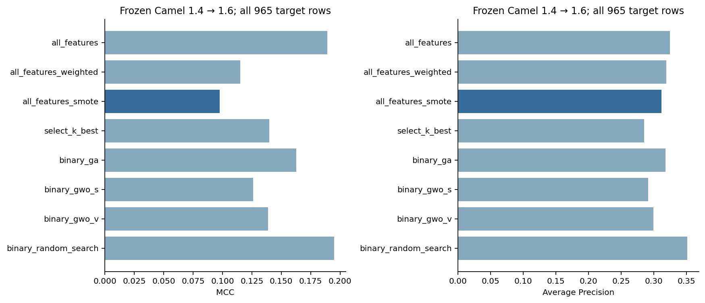

# Software Defect Prediction

Can binary GA/GWO feature selection reduce software metrics while preserving defect prediction across versions? **Binary GA retained 9/20 metrics and achieved target MCC 0.1627, compared with 0.1151 for weighted all-feature LR.**



Random Search retained 8/20 metrics with MCC **0.1951**, exceeding GA and both GWO variants in this observed target pass. The development-selected SMOTE candidate reached only **0.0975** target MCC; it remains the frozen candidate. These findings do not establish statistical superiority.

This completed historical Camel 1.4 → 1.6 experiment measures feature reduction, class imbalance interventions and transfer under a fixed compute budget. The development-selected candidate is **all_features_smote**; the eight target scores are descriptive comparisons. This is a portfolio research study, with no claim of a new state-of-the-art method.

## Results and methods

| Method | Features | MCC | F1 | Recall | Precision | AP | TN/FP/FN/TP |
|---|---:|---:|---:|---:|---:|---:|---|
| all_features | 20 | 0.1890 | 0.2060 | 0.1277 | 0.5333 | 0.3243 | 756/21/164/24 |
| all_features_weighted | 20 | 0.1151 | 0.3260 | 0.4362 | 0.2603 | 0.3187 | 544/233/106/82 |
| all_features_smote | 20 | 0.0975 | 0.3126 | 0.4149 | 0.2508 | 0.3118 | 544/233/110/78 |
| select_k_best | 10 | 0.1398 | 0.3433 | 0.4574 | 0.2748 | 0.2847 | 550/227/102/86 |
| binary_ga | 9 | 0.1627 | 0.3556 | 0.4521 | 0.2931 | 0.3179 | 572/205/103/85 |
| binary_gwo_s | 10 | 0.1262 | 0.3262 | 0.4043 | 0.2734 | 0.2914 | 575/202/112/76 |
| binary_gwo_v | 12 | 0.1388 | 0.3402 | 0.4415 | 0.2767 | 0.2992 | 560/217/105/83 |
| binary_random_search | 8 | 0.1951 | 0.3789 | 0.4787 | 0.3136 | 0.3513 | 580/197/98/90 |

All models use Logistic Regression (`liblinear`, C=1, max_iter=2000, seed=0), threshold 0.5 and training-fold StandardScaler. Baselines include balanced class weights, SMOTE (seed=2029, k=5), and fold-local SelectKBest (ANOVA, k=10). Binary GA, GWO-S, GWO-V and binary Random Search use the real [metaheuristics-lab](https://github.com/Ehsan-Rezaeii/metaheuristics-lab) package at `6b4ef0fa3d72f608146f3dd7eabb84bf39fa896e`, with population 12 and 90 objective calls each. The objective combines MCC, AP and feature count; no fitness cache is used.

Camel 1.4 alone supplies three-fold nested StratifiedGroupKFold development (outer seed=2027, inner seed=2028), grouped by identical full metric vectors. Full-development searches use seeds 0, 1, 2; final masks and all settings were committed and pushed before one eight-model target pass. There were **2160 objective calls, 6480 inner fits, 24 outer fits, and 8 final fits**. [Full results](docs/RESULTS.md) include all subgroups, masks, timing, stability and negative comparisons.

## Install and verify

Python 3.10, 3.12 and 3.13 are supported by the CI matrix. Git is needed for the pinned optimizer dependency.

```bash
python -m venv .venv
source .venv/bin/activate
python -m pip install -e '.[dev]'
sdp smoke
pytest --cov=software_defect_prediction --cov-report=term-missing
sdp audit-results
```

Smoke uses synthetic data and runs offline. CI never downloads real data or reruns scientific training. See [actual verification evidence](docs/VERIFICATION.md) for local checks, coverage, CI URLs and commit identities.

## Reproduce the study

The checked-in [study artifacts](results/study/) are immutable. Use a fresh output directory for reproduction and follow the [full command sequence](docs/VERIFICATION.md). Downloaded CSVs stay in ignored `data/raw/`. Development reads Camel 1.4 only; `sdp final` checks committed/pushed freeze identities, environment, settings and byte hashes, and creates an exclusive STARTED marker. It refuses repeat scoring in the same output, including after an interrupted pass. [Scientific protocol](docs/EXPERIMENT_PROTOCOL.md) and [specification](docs/PROJECT_SPEC.md) predate training.

## Limits and attribution

This is within-project historical transfer: 857 class IDs and 296 distinct metric vectors overlap across releases. Duplicate vectors occur in both versions; three target duplicate-vector groups have conflicting labels. Source/target defect prevalence differs; metrics are correlated and the three-fold/three-seed budget cannot establish significance or cross-project robustness. See [limitations and seen/unseen support](docs/RESULTS.md#interpretation-and-limitations). Target results never selected the final candidate.

Data: [awsm-research/DefectData](https://github.com/awsm-research/DefectData) revision `7d9a07306ef651fb909344be359dc3523f1db8c5`, Tera-PROMISE CK corpus; Jureczko and Madeyski (2010), DOI [10.1145/1868328.1868342](https://doi.org/10.1145/1868328.1868342). [Provenance and actual SHA-256 hashes](docs/DATASET_PROVENANCE.md) and [machine-readable manifest](results/study/dataset_manifest.json). Raw-data rights remain separate from this code's [MIT license](LICENSE); no raw CSVs are redistributed.

Project 3 in [Ehsan Rezaei's portfolio](https://github.com/Ehsan-Rezaeii), reusing [Project 1: metaheuristics-lab](https://github.com/Ehsan-Rezaeii/metaheuristics-lab). Source attribution is preserved; optimizers are imported without vendoring.
