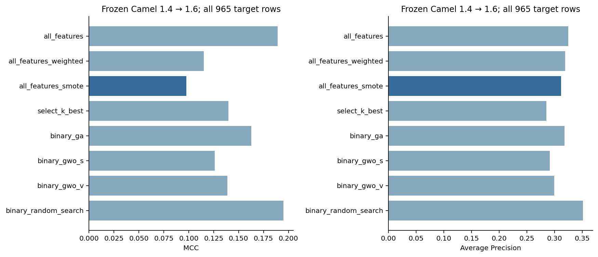
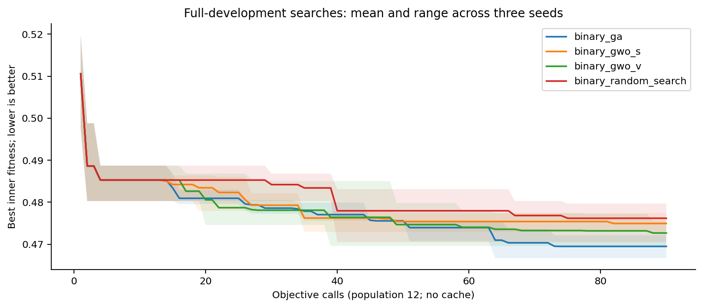
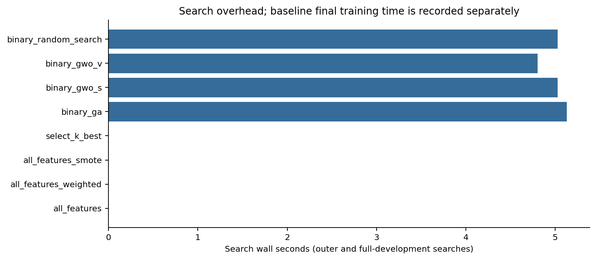
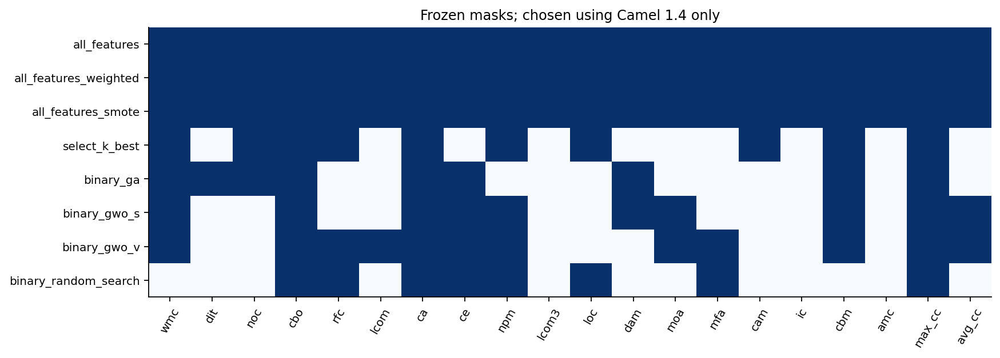
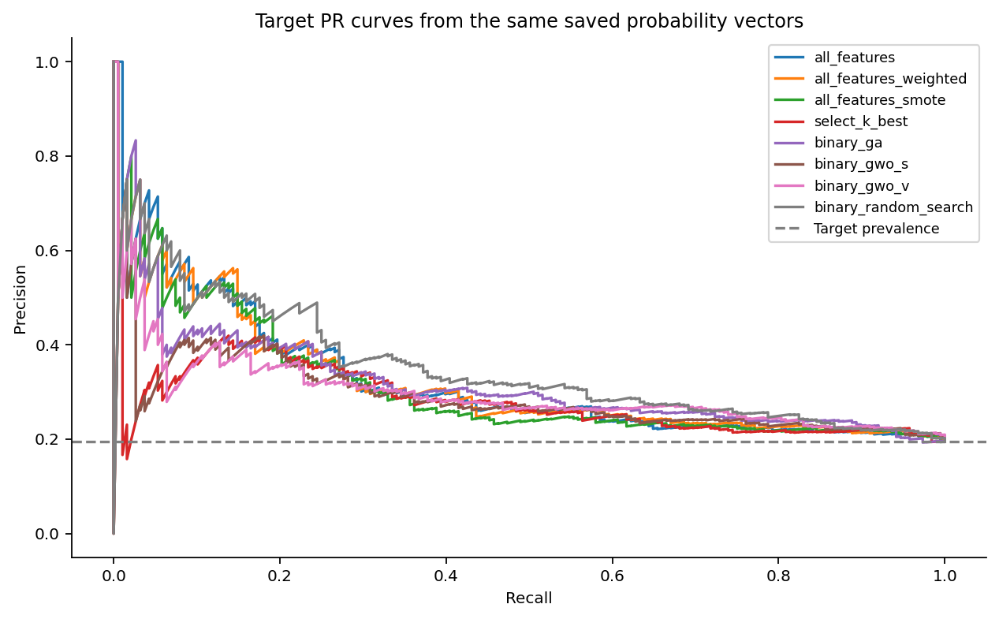
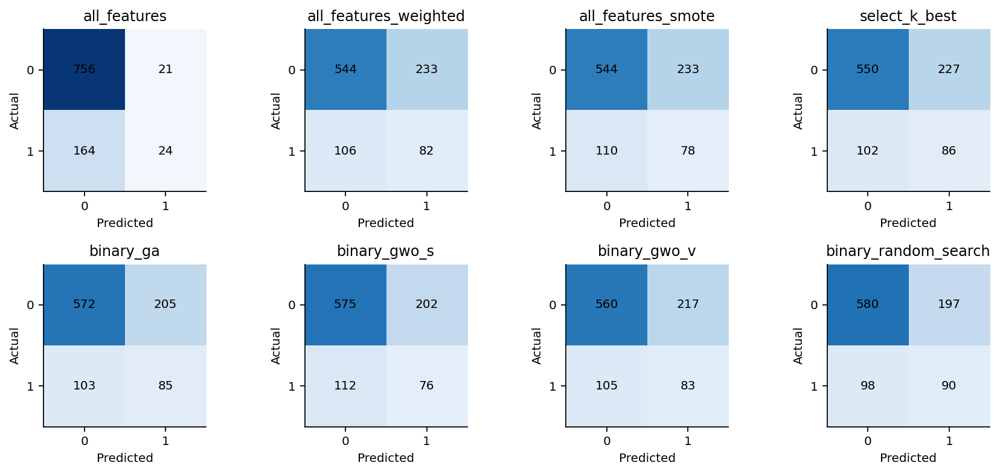

# Measured Camel cross-version results

Research question: can binary feature selection reduce software metrics while preserving cross-version defect detection? Binary GA retained 9/20 metrics and achieved target MCC 0.1627, compared with 0.1151 for weighted all-feature LR.

All eight pre-registered configurations are reported. These are descriptive measurements from one historical release pair; no statistical significance or state-of-the-art claim is made. The final candidate was **all_features_smote**, selected exclusively by highest mean outer-development MCC (0.2930); target scores did not change it. Each optimizer's final mask was chosen independently by pre-registered minimum full-development inner fitness, with feature-count/seed/bitmask tie breaks.

## Whole target: 965 classes, 188 positive

| Method | Features | MCC | F1 | Recall | Precision | AP | TN/FP/FN/TP |
|---|---:|---:|---:|---:|---:|---:|---|
| all_features | 20 | 0.1890 | 0.2060 | 0.1277 | 0.5333 | 0.3243 | 756/21/164/24 |
| all_features_weighted | 20 | 0.1151 | 0.3260 | 0.4362 | 0.2603 | 0.3187 | 544/233/106/82 |
| all_features_smote | 20 | 0.0975 | 0.3126 | 0.4149 | 0.2508 | 0.3118 | 544/233/110/78 |
| select_k_best | 10 | 0.1398 | 0.3433 | 0.4574 | 0.2748 | 0.2847 | 550/227/102/86 |
| binary_ga | 9 | 0.1627 | 0.3556 | 0.4521 | 0.2931 | 0.3179 | 572/205/103/85 |
| binary_gwo_s | 10 | 0.1262 | 0.3262 | 0.4043 | 0.2734 | 0.2914 | 575/202/112/76 |
| binary_gwo_v | 12 | 0.1388 | 0.3402 | 0.4415 | 0.2767 | 0.2992 | 560/217/105/83 |
| binary_random_search | 8 | 0.1951 | 0.3789 | 0.4787 | 0.3136 | 0.3513 | 580/197/98/90 |

## Development evidence, separate from target scores

| Method | MCC mean ± sample SD | AP mean ± sample SD |
|---|---:|---:|
| all_features | 0.1456 ± 0.0919 | 0.3362 ± 0.0574 |
| all_features_weighted | 0.2708 ± 0.0713 | 0.3535 ± 0.0643 |
| all_features_smote | 0.2930 ± 0.0431 | 0.3590 ± 0.0642 |
| select_k_best | 0.2460 ± 0.0802 | 0.3350 ± 0.0868 |
| binary_ga | 0.2283 ± 0.0096 | 0.3081 ± 0.0540 |
| binary_gwo_s | 0.2706 ± 0.0272 | 0.3410 ± 0.0703 |
| binary_gwo_v | 0.2481 ± 0.0307 | 0.3388 ± 0.0740 |
| binary_random_search | 0.2819 ± 0.0232 | 0.3331 ± 0.0841 |

Three folds are correlated and do not establish significance. Outer fits use masks selected only inside their training part; full-development seed selection is a separate inner-CV procedure. Inner optimized fitness is not an unbiased performance estimate. Source duplicate-vector groups remain disjoint in every inner and outer fold. See `development.json` for every fold index and probability vector.

| Search | Calls | Classifier fits | Seconds | Three-seed Jaccard pairs |
|---|---:|---:|---:|---|
| binary_ga | 540 | 1620 | 5.132 | [0, 1]: 0.538, [0, 2]: 0.667, [1, 2]: 0.500 |
| binary_gwo_s | 540 | 1620 | 5.028 | [0, 1]: 0.467, [0, 2]: 0.500, [1, 2]: 0.583 |
| binary_gwo_v | 540 | 1620 | 4.804 | [0, 1]: 0.312, [0, 2]: 0.375, [1, 2]: 0.643 |
| binary_random_search | 540 | 1620 | 5.030 | [0, 1]: 0.167, [0, 2]: 0.308, [1, 2]: 0.583 |

There were 2160 objective calls, 6480 actual inner classifier fits, 24 outer classifier fits, and exactly 8 target-stage classifier fits. Empty and repeated masks count; empty masks require no fit. Development took 21.269 wall seconds; final fit time was 0.028 seconds and prediction time 0.003 seconds. Timing is machine-dependent and objective cost is distinct from final fit cost.

## Frozen features

| Method | Seed | Features |
|---|---:|---|
| all_features | None | wmc, dit, noc, cbo, rfc, lcom, ca, ce, npm, lcom3, loc, dam, moa, mfa, cam, ic, cbm, amc, max_cc, avg_cc |
| all_features_weighted | None | wmc, dit, noc, cbo, rfc, lcom, ca, ce, npm, lcom3, loc, dam, moa, mfa, cam, ic, cbm, amc, max_cc, avg_cc |
| all_features_smote | None | wmc, dit, noc, cbo, rfc, lcom, ca, ce, npm, lcom3, loc, dam, moa, mfa, cam, ic, cbm, amc, max_cc, avg_cc |
| select_k_best | None | wmc, noc, cbo, rfc, ca, npm, loc, cam, cbm, max_cc |
| binary_ga | 1 | wmc, dit, noc, cbo, ca, ce, dam, cbm, max_cc |
| binary_gwo_s | 1 | wmc, cbo, ca, ce, npm, dam, moa, cbm, max_cc, avg_cc |
| binary_gwo_v | 2 | wmc, cbo, rfc, lcom, ca, ce, npm, moa, mfa, cbm, max_cc, avg_cc |
| binary_random_search | 1 | cbo, rfc, ca, ce, npm, loc, mfa, max_cc |

## Seen/unseen-class diagnostics

| Method | Subgroup | n | Positive | MCC | F1 | Recall | Precision | AP | TN/FP/FN/TP |
|---|---|---:|---:|---:|---:|---:|---:|---:|---|
| all_features | seen_id | 857 | 171 | 0.1966 | 0.2222 | 0.1404 | 0.5333 | 0.3409 | 665/21/147/24 |
| all_features | unseen_id | 108 | 17 | undefined | 0.0000 | 0.0000 | undefined | 0.1848 | 91/0/17/0 |
| all_features_weighted | seen_id | 857 | 171 | 0.1372 | 0.3465 | 0.4620 | 0.2772 | 0.3335 | 480/206/92/79 |
| all_features_weighted | unseen_id | 108 | 17 | -0.0978 | 0.1277 | 0.1765 | 0.1000 | 0.2528 | 64/27/14/3 |
| all_features_smote | seen_id | 857 | 171 | 0.1191 | 0.3326 | 0.4386 | 0.2679 | 0.3251 | 481/205/96/75 |
| all_features_smote | unseen_id | 108 | 17 | -0.1056 | 0.1250 | 0.1765 | 0.0968 | 0.2550 | 63/28/14/3 |
| select_k_best | seen_id | 857 | 171 | 0.1571 | 0.3604 | 0.4795 | 0.2887 | 0.3036 | 484/202/89/82 |
| select_k_best | unseen_id | 108 | 17 | -0.0324 | 0.1739 | 0.2353 | 0.1379 | 0.1701 | 66/25/13/4 |
| binary_ga | seen_id | 857 | 171 | 0.1913 | 0.3805 | 0.4795 | 0.3154 | 0.3371 | 508/178/89/82 |
| binary_ga | unseen_id | 108 | 17 | -0.0978 | 0.1277 | 0.1765 | 0.1000 | 0.1834 | 64/27/14/3 |
| binary_gwo_s | seen_id | 857 | 171 | 0.1514 | 0.3484 | 0.4269 | 0.2944 | 0.3074 | 511/175/98/73 |
| binary_gwo_s | unseen_id | 108 | 17 | -0.0978 | 0.1277 | 0.1765 | 0.1000 | 0.1833 | 64/27/14/3 |
| binary_gwo_v | seen_id | 857 | 171 | 0.1642 | 0.3628 | 0.4678 | 0.2963 | 0.3153 | 496/190/91/80 |
| binary_gwo_v | unseen_id | 108 | 17 | -0.0978 | 0.1277 | 0.1765 | 0.1000 | 0.1816 | 64/27/14/3 |
| binary_random_search | seen_id | 857 | 171 | 0.2171 | 0.4000 | 0.5088 | 0.3295 | 0.3638 | 509/177/84/87 |
| binary_random_search | unseen_id | 108 | 17 | -0.0385 | 0.1500 | 0.1765 | 0.1304 | 0.2744 | 71/20/14/3 |

Subgroups use the same saved probabilities with no additional fits or predictions. The 857 seen and 108 unseen class IDs are temporal-overlap diagnostics. Missing either true class makes F1, recall, precision and AP undefined; MCC is also undefined for any zero denominator. Confusion counts and predicted-positive fractions remain available. Inner fitness maps undefined zero-denominator MCC to 0, explicitly, following sklearn's convention. AP is Average Precision, not trapezoidal PR-AUC.

## Interpretation and limitations

The primary negative finding is that GA/GWO do not outperform the simple Random Search comparator on this target: Random Search retained 8 metrics with MCC 0.1951 and AP 0.3513, versus GA's 9 metrics, MCC 0.1627 and AP 0.3179. GWO-S and GWO-V reached MCC 0.1262 and 0.1388. GA's gain over weighted all-feature LR (MCC 0.1151) therefore does not demonstrate a benefit specific to evolutionary search. Unweighted all-feature LR reached MCC 0.1890 but recalled only 24/188 defects (0.1277), illustrating why MCC, recall, AP and confusion counts must be read together.

The development-selected SMOTE candidate's outer MCC mean was 0.2930 but its target MCC was 0.0975. It missed 110 defects and produced 233 false positives. We preserved this unfavorable transfer result and did not replace the candidate with Random Search after target inspection. Development estimates did not reliably order the later release's performance.

The unseen-ID subgroup has 108 classes, including just 17 positives and 91 negatives. GA/GWO each detect 3 of those 17 defects; Random Search also detects 3, while unweighted LR detects none. All nontrivial unseen-ID MCC values are negative; the unweighted model's MCC and precision are undefined because it predicts no positives. This is weak evidence for usefulness on new classes, despite the more favorable whole-target scores. No causal effect of ID overlap is inferred.

Compare every row with weighted LR, the filter and Random Search before attributing value to GA/GWO. Feature reduction incurs thousands of training fits; favorable target differences alone cannot establish optimizer superiority. The three-seed mask overlaps quantify instability under this fixed, small budget. Negative comparisons remain in the tables.

There are 872 source rows (145 positive) and 965 target rows (188 positive), a prevalence shift from 16.63% to 19.48%. Source data contain 31 duplicate-vector groups and 70 excess rows; target data contain 38 groups and 84 excess rows, including 3 conflicting-label groups. There are 296 shared vectors and 857 shared class IDs. Grouping prevents source CV duplicate-vector leakage, but cannot make the releases independent. Historical defect counts may reflect inconsistent reporting and are not current production ground truth. Metrics share the same predictions and are correlated. Three folds/seeds and population 12 with 90 calls are chosen engineering budgets; conclusions do not generalize to other budgets, learners, projects or future releases. Unseen-class support, especially missing positive support when present, limits conclusions about new classes. No row was removed or relabeled.

## Evidence

Freeze commit: `4140a5124bd76a4710c39da5a9053accccdd26f9`. [Raw artifacts](../results/study/) include data identities, anonymous development fold evidence, every evaluated mask/fitness, chosen masks, environment, freeze, STARTED/COMPLETED chronology, target probabilities and fit times. [Protocol](EXPERIMENT_PROTOCOL.md), [provenance](DATASET_PROVENANCE.md), and [verification](VERIFICATION.md) separate fixed settings from these measured findings. Reports and plots are generated without fitting models.
